# Manual del estudiante de «Estudiar»

Guía breve de lo que de verdad hace hoy «Estudiar», la biblioteca de lecciones de Anato3D, y de Neuri, su asistente. Las capturas se tomaron el 9 de noviembre de 2026 en el servidor de desarrollo.

**Cómo leer las capturas:** donde dice **«IA simulada»**, el servidor de Neuri se sustituyó en la página por uno de prueba: la interfaz es la real, pero no hubo IA. Hoy la app no tiene clave de API, así que Neuri responde **con el buscador de la app**: así es la captura 8.

**Lo que no hay todavía:** cuentas, sincronización entre dispositivos ni una web publicada. Se explican en el recorrido 9 y en «Limitaciones».

---

## 1. Entrar como invitado, elegir nivel y empezar una lección

1. En la pantalla de inicio, pulsa **Iniciar**. No hace falta registrarse: todo lo que hagas se guarda en este navegador.
2. Pulsa el birrete de la barra de arriba para abrir **Estudiar**.
3. La entrada pregunta **«¿Qué quieres aprender hoy?»**. Puedes:
   - escribir en el buscador;
   - pulsar un ejemplo («huesos de la mano», «corazón»…);
   - usar una de las seis acciones: **Continuar donde lo dejé**, **Explorar la biblioteca**, **Repasar mis dificultades**, **Preparar un examen**, **Pedir ayuda a Neuri** y **Mis lecciones**.
4. **Tus preferencias** son opcionales:
   - nivel (básico, intermedio, avanzado);
   - tiempo por sesión;
   - hasta 8 regiones o sistemas que te interesen.

   Ordenan lo que se te propone; no esconden nada.
5. En una lección, pulsa **Empezar**, o **Seguir** si ya la empezaste.

| | |
| --- | --- |
| 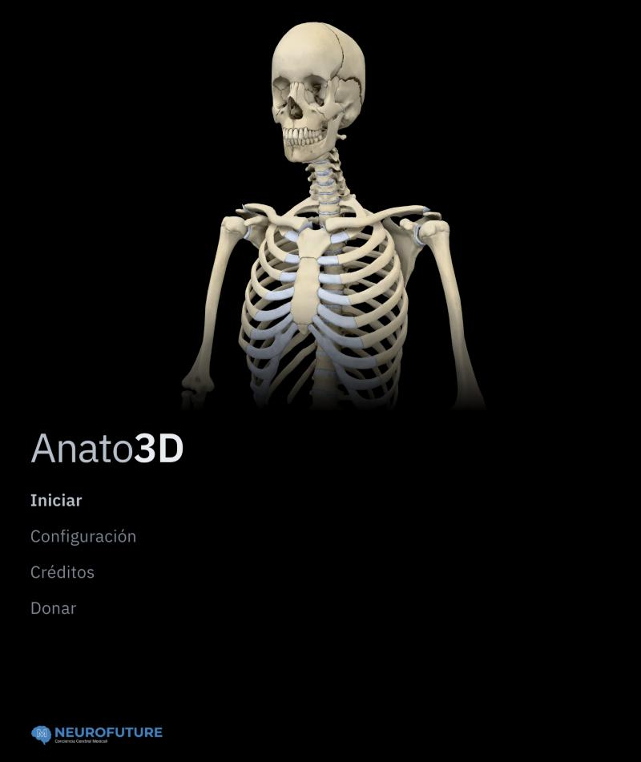 | 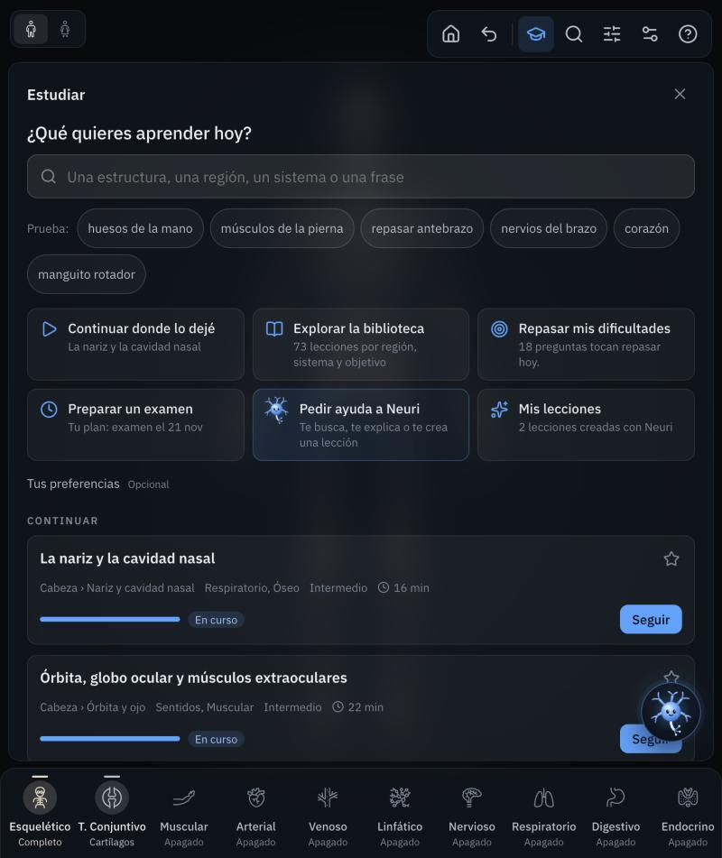 |

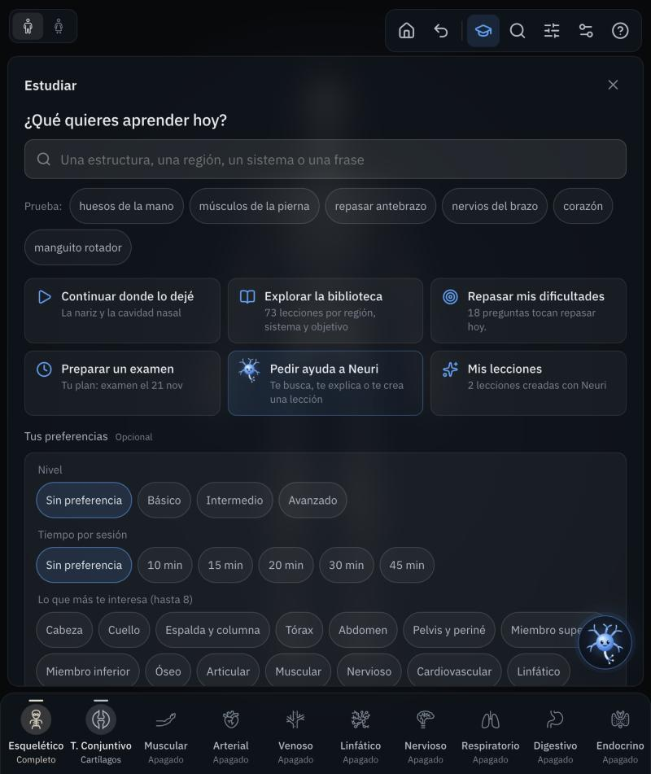

## 2. Buscar, combinar filtros y volver al catálogo

**Buscar:**
- Escribe lo que buscas: una estructura («nervio radial»), una región («miembro superior»), un sistema («digestivo») o una frase («músculos de la pierna»).
- Entiende erratas razonables y palabras sin acentos («musculos», «biceps»).
- Arriba dice lo que ha **Entendido** (por ejemplo, «Miembro superior › Brazo · Compartimentos»). Si una palabra es ambigua, lo aclara: en anatomía, el *brazo* va del hombro al codo.

**Filtros**, combinables:
- región y subregión;
- sistema, formato y tema u objetivo;
- nivel y duración;
- progreso, «con repaso pendiente» y guardadas;
- idioma del contenido, procedencia (biblioteca o Mis lecciones) y tipo de estructura.

Los filtros activos se ven arriba y se quitan uno a uno o con **Quitar todos**. Si nada cumple todos a la vez, la app propone cuál quitar y cuántas lecciones aparecerían.

**Ordenar:** por relevancia, secuencia recomendada, duración o lo más reciente.

**Volver:** al salir de una lección o de su ficha («‹ Biblioteca»), recuperas la misma búsqueda, los mismos filtros y el mismo orden.

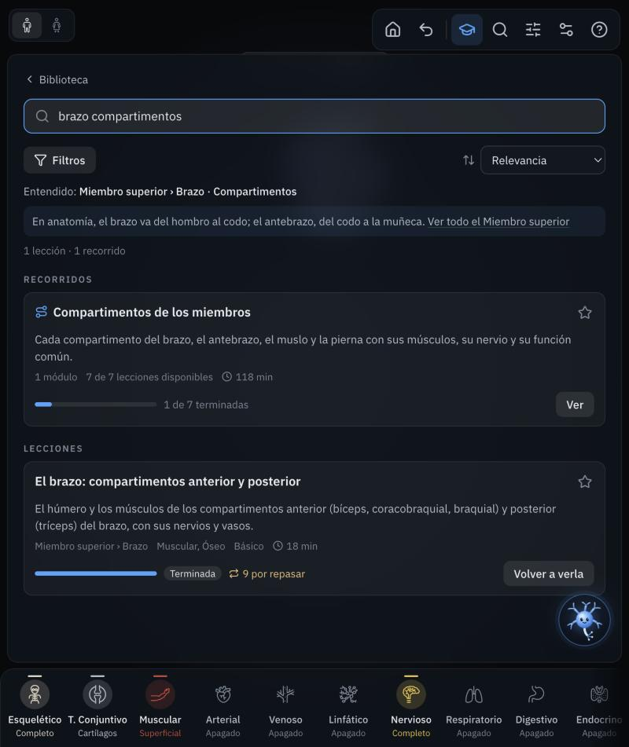

## 3. Estudiar con el visor, consultar fuentes, practicar y evaluarte

1. **Cada paso de la lección** muestra en el modelo 3D lo que explica. Arriba tienes:
   - **Vista aislada**: solo lo del paso;
   - **Restaurar**: vuelve a la vista del paso si moviste el modelo.

   «En el modelo» lista las estructuras del paso. Si el modelo no tiene una pieza, la lección lo dice y adapta la actividad. Si una pieza tiene un error conocido en el modelo, el paso lo avisa en ámbar (ver «Limitaciones conocidas»).
2. **Las fuentes:**
   - cada afirmación lleva la frase de la fuente que la respalda, en su idioma original y comprobada palabra por palabra;
   - ábrelas en **Fuentes de este paso**;
   - **Saber más** amplía el paso.
3. **Las actividades:** señalar una estructura en el modelo, comparar dos o una pregunta para comprobar el paso. Te ayudan durante la lección, pero no cuentan en tu mapa: ahí solo cuentan las evaluaciones, los repasos y las prácticas.
4. **La evaluación:**
   - al terminar, **Evaluarme ahora**;
   - las preguntas son de identificar en 3D, localizar, relaciones, función, comparación y orden, sin pistas que revelen la respuesta;
   - el resultado se da por objetivo. Hay **aprendizaje demostrado** con el 80 % o más y algún acierto en cada objetivo;
   - no se hacen las preguntas que piden en el modelo una pieza con un error conocido. El resultado dice cuántas fueron y, si un objetivo se queda sin ninguna, lo marca «sin evaluar».
5. **Practicar:**
   - repaso de hoy, repaso de errores, identificación en 3D sin etiquetas o una sesión según tu tiempo;
   - en repasos y prácticas, una estructura que ya reconociste se pide **escribiendo su nombre**. Si lo escrito se parece pero no coincide, te compararás con la respuesta y contará como duda. **Prefiero ver opciones** y **No lo sé** siempre están disponibles.

| | |
| --- | --- |
| 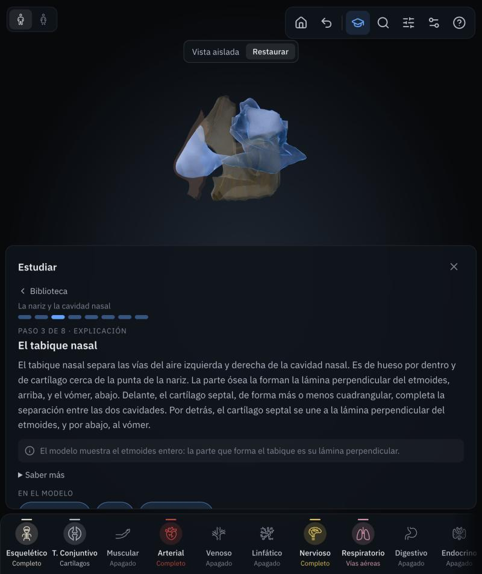 | 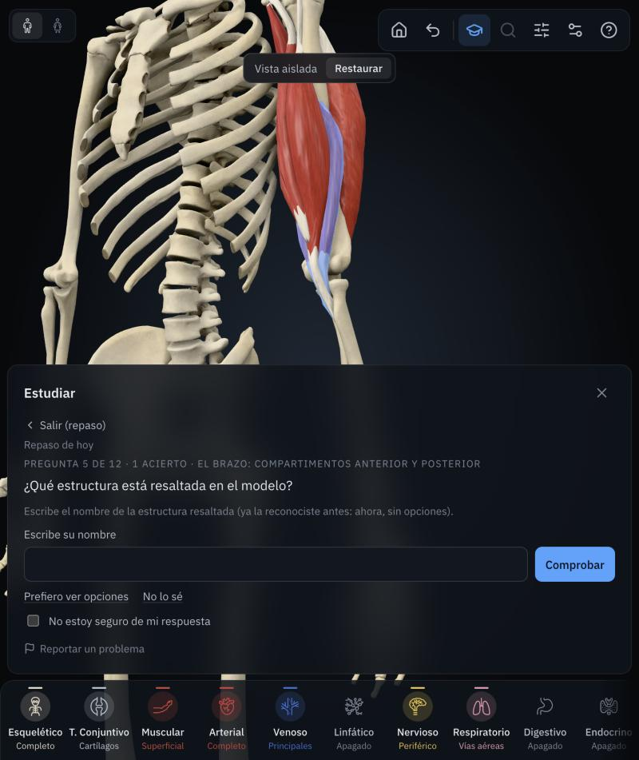 |

## 4. Entender tu progreso, tus dificultades y los repasos

En la entrada, **Repasar mis dificultades** abre **Tu mapa de aprendizaje**, que se calcula con tus respuestas en evaluaciones, repasos y prácticas.

**Lecciones:** empezadas, terminadas, con aprendizaje demostrado y consolidadas. Abrir o leer no cuenta como comprensión, y un acierto suelto no basta para consolidar.

**Habilidades:** reconocer, localizar, relacionar, explicar su función y comparar. Cada una está sin datos, practicando, demostrada o consolidada.

**Lo que te está costando:** cada dificultad dice por qué (por ejemplo, «la confundiste con…»). Desde cada una puedes:
- **Practicar esto**: otra pregunta sobre lo mismo, no la que acabas de fallar;
- **Ver el paso de la lección**;
- **Aplazar un día**.

**Repasos pendientes:** **Repasar ahora** o **Aplazarlos a mañana**. El repaso es espaciado: lo que aciertas con seguridad vuelve más tarde; lo que fallas, pronto.

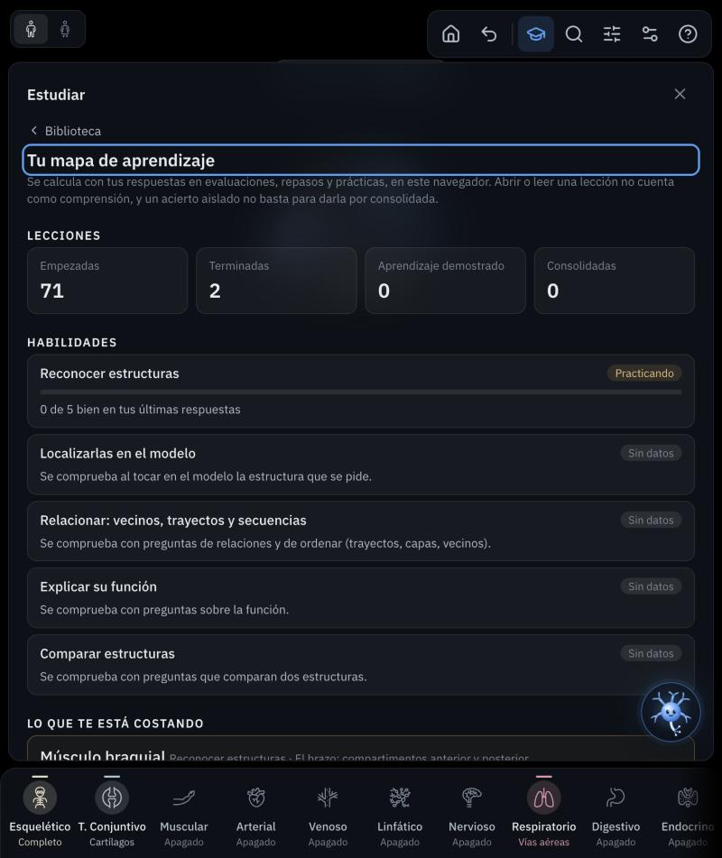

## 5. Hablar con Neuri, corregir lo que entendió y abrir recomendaciones

**Abrir Neuri:** **Pedir ayuda a Neuri** en la entrada, o el botón flotante con la neurona.

**Qué puedes pedirle:**
- **lecciones:** «Tengo examen del brazo», «Algo de 10 minutos»;
- **explicaciones:** «¿Qué hace el manguito rotador?»;
- **lecciones nuevas:** «Crea una lección sobre la nariz».

**Con IA** («Con IA (Claude)» bajo su nombre):
- conserva el tema, el objetivo, el nivel y los minutos durante la conversación;
- explica con citas de las fuentes de la biblioteca.

**Sin IA** («Con el buscador de la app»): recomienda con el buscador y lo que escribes no sale de tu dispositivo. Es lo que hace hoy (sin clave de API).

**Corregir lo que entendió:** contéstale sin más («más corto», «no, del antebrazo», «nivel básico»). Una propuesta de lección muestra lo que entendió (tema, objetivo, nivel, duración y supuestos), y **Cambiar algo** te lleva a escribir qué corregir antes de planificarla.

**Las recomendaciones** son tarjetas: **Empezar** o **Seguir** abre la lección, y la estrella la guarda. Neuri solo recomienda lecciones que existen y se pueden abrir.

**No da consejos médicos personales:** te remite a un profesional y, en una urgencia, a los servicios de emergencia. Con IA, tampoco responde a temas ajenos a la anatomía.

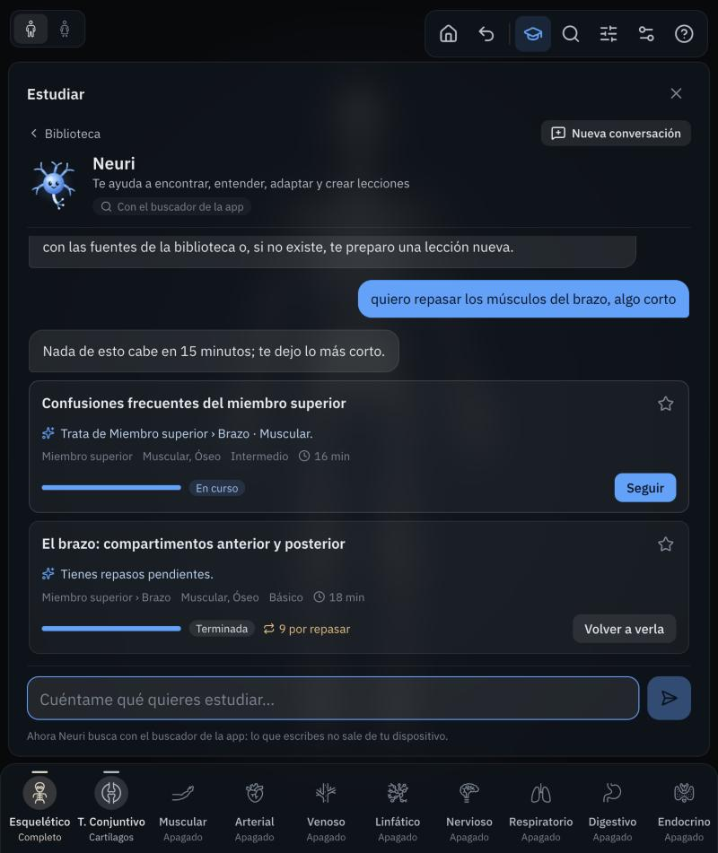

### Una sesión de estudio con Neuri (desde el 12 nov 2026)

Una sesión es un plan para estudiar un rato con lo que ya hay en la biblioteca. Se guarda en este navegador y puedes dejarla y seguir después.

1. **Pedirla:** dile a Neuri, por ejemplo, «Prepárame una sesión de 10 minutos sobre el corazón». También puedes pulsar **Proponer una sesión** en la entrada.
   - Si el tema está claro, la prepara tu dispositivo, **sin IA** («Planificada en tu dispositivo, sin IA»).
   - Si mezcla temas o no está claro, la prepara Neuri con la IA («Planificada por Neuri con IA»). Sin IA, te pregunta sobre qué tema.
2. **Qué trae:** de 1 a 6 bloques en orden: **repaso de lo que toca**, una **lección** entera o una parte, y una **práctica** con preguntas de lo que acabas de estudiar. Cada bloque dice por qué está ahí.
3. **Hacerla:** **Empezar**, y cada bloque te lleva a la lección o a las preguntas de siempre. En la vista de la sesión tienes también **Saltar bloque** y **Terminar sesión** (lo hecho se conserva).
4. **Dejarla y seguir:** si sales o recargas, **Continuar la sesión** te devuelve al bloque y al paso o la pregunta donde estabas. Solo hay una sesión en curso: si empiezas otra, la anterior queda en pausa.
5. **Pista y segundo intento:** dentro de una sesión, si fallas una pregunta, la opción fallada se retira y recibes una **pista**: una frase de la lección donde se enseña, sin el nombre de la respuesta. Si aciertas así, cuenta **«con ayuda»**: no sube en el repaso espaciado ni cuenta como aprendizaje demostrado, y la pregunta vuelve pronto. Si fallas otra vez, ves la respuesta y la explicación.
6. **Al terminar:** el resumen dice cuántas acertaste a la primera, con ayuda y con la respuesta a la vista, qué conviene repasar y cuándo vuelve, y dos siguientes pasos.

**Mis sesiones** (en la entrada y en «Mis lecciones»): primero las que están en curso; después las terminadas. Cada una se puede abrir, **repetir** o quitar. Quitar una sesión no borra lo que estudiaste. Se guardan como mucho 20: al pasarte se quitan primero las que nunca empezaste y las terminadas más antiguas, nunca la que está en curso, y la app te avisa.

### Preguntar a Neuri desde una lección y verlo en 3D

- En un paso de una lección, **Preguntar a Neuri sobre este paso** abre la conversación sabiendo dónde estás («Sobre: …»; puedes quitarlo). Si el paso tiene una pregunta de comprobación, el botón sale cuando ya la has respondido.
- Si preguntas por una pregunta de práctica o de evaluación, Neuri no te da la respuesta: te da una pista o te dice en qué paso se explica.
- **Ver en 3D:** algunas respuestas traen botones para enseñar la estructura en el modelo sin cerrar el panel. «Muéstrame el fémur» funciona también sin IA.
- **Neuri recuerda el tema entre visitas** (el tema, el objetivo, el nivel y los minutos; nunca los mensajes) durante 30 días. «Borrar mis datos» lo olvida.

### Cuántas preguntas con IA tienes al día

Cada dispositivo tiene un **cupo diario**: **30 preguntas con IA y 3 creaciones de lecciones**. Lo ves arriba de la conversación («IA: quedan … de … preguntas hoy · se renueva …»).
- **No gastan:** lo que se resuelve en tu dispositivo (búsquedas, «el segundo», las sesiones sin IA, el repaso).
- **Planificar una lección ya cuenta como creación**, aunque todavía no la hayas creado.
- **Al acabarse:** Neuri responde con la biblioteca («Hoy ya no quedan preguntas con IA; te respondo con la biblioteca») y todo lo demás sigue igual. Una creación pendiente queda en pausa y sigue sola cuando se renueva.
- **Se renueva a medianoche** (hora de Mexicali).
- Para contarlo, la app guarda un **identificador aleatorio de este dispositivo**. No dice quién eres, no va a la IA y no se exporta; si borras tus datos, se crea otro.

**Capturas que faltan** (no se han tomado todavía): la tarjeta de una sesión propuesta, la vista de sesión con sus bloques, la pista del segundo intento, el resumen final, «Mis sesiones», «Preguntar a Neuri sobre este paso» con el enfoque «Sobre: …», «Ver en 3D» y el saldo del cupo, con el aviso de cupo agotado.

## 6. Pedir una lección, ver cómo se prepara, cancelarla o abrirla

Necesita la IA, así que hoy solo funciona con la clave de API configurada. Las capturas son con la **IA simulada**.

1. **Pedirla:** si se la pides claramente («Créame una lección corta sobre los huesos de la nariz»), empieza enseguida. Si Neuri te la propone, pulsa **Planificar la lección** y luego **Crear la lección**, o **Cambiar el plan**.
2. **La tarjeta de la creación** muestra las etapas reales:
   - planificando;
   - buscando las fuentes;
   - redactando, con cuántas evidencias;
   - comprobando que cada cita respalda lo que dice (y corrigiendo, si hace falta);
   - guardando en Mis lecciones.

   **Ver el plan** enseña objetivos, pasos y estructuras.
3. **Mientras tanto** puedes seguir usando la app. Si recargas la página, la creación se retoma sin repetirla ni pagarla dos veces. Si el servidor ya no la tiene, queda «interrumpida» y tú decides si volver a empezar.
4. **Cancelar** la detiene y no se guarda nada.
5. **Cuando termina:**
   - aparece **Lista para estudiar**, con lo que tiene (pasos, preguntas, citas comprobadas) y lo que se quitó por no estar respaldado;
   - **Abrir la lección** o **Ver la ficha**;
   - si cerraste el panel, un aviso ofrece **Abrir la lección**.
6. **Si no se pudo:** la tarjeta dice por qué (sin IA, tiempo agotado, sin fuentes suficientes para ese tema…) y ofrece **Intentarlo de nuevo** cuando tiene sentido.

**Toda lección de Neuri es un borrador generado con IA**, sin revisión de un especialista, y la app lo dice siempre.

| | |
| --- | --- |
| 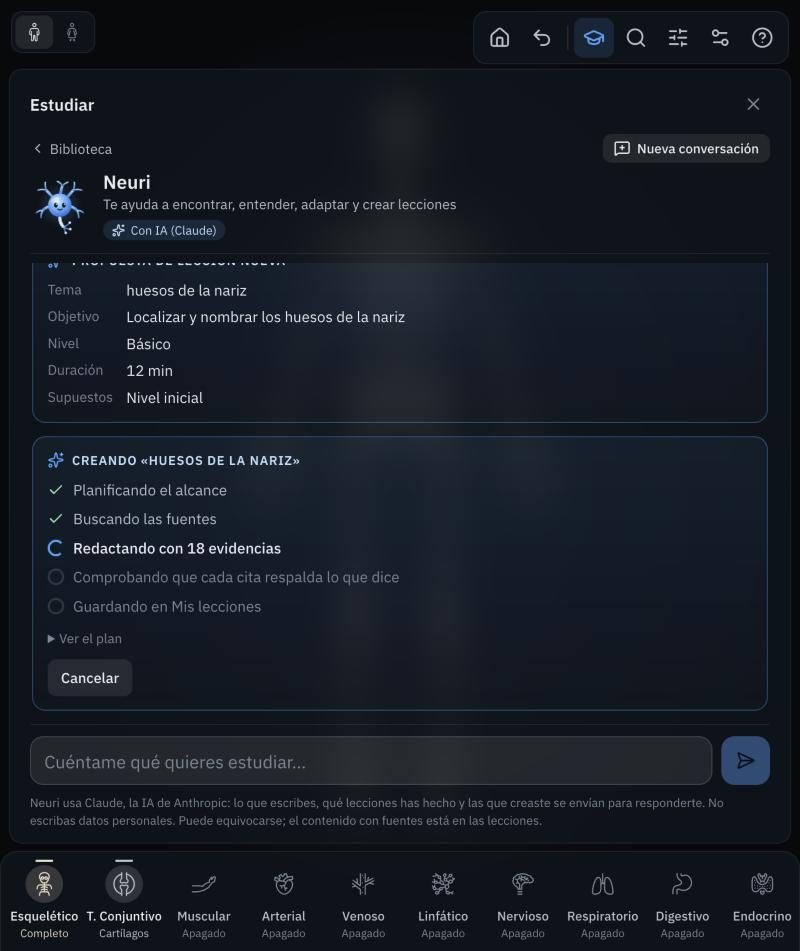 | 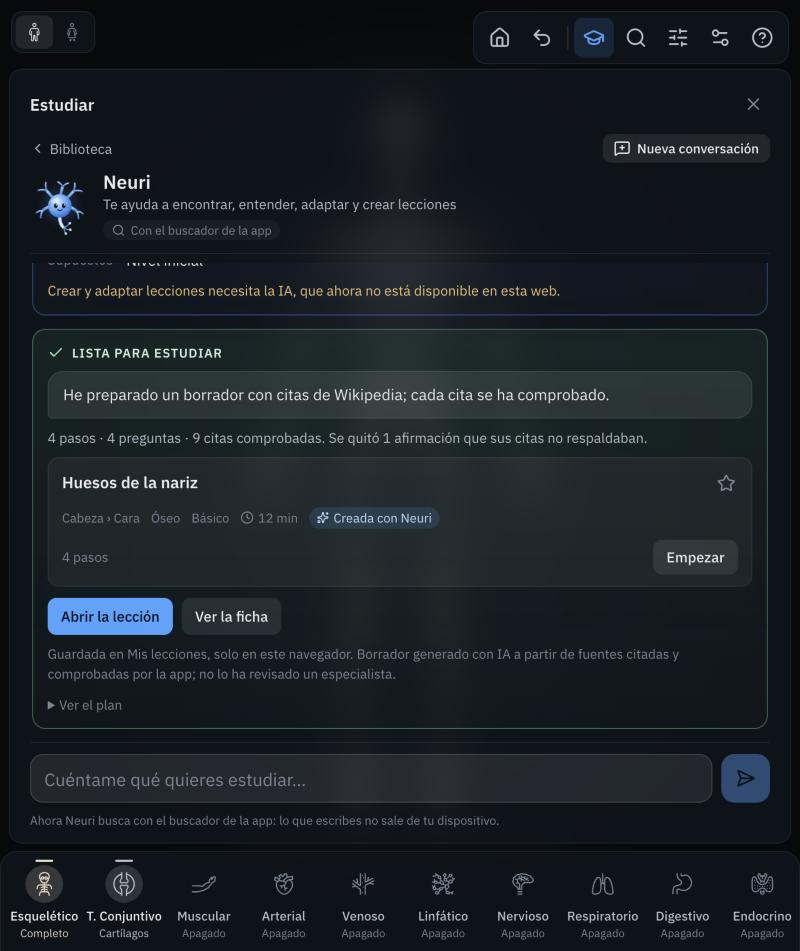 |

En la captura 10, la lección se creó con la IA simulada. Luego se recargó la página sin simulación: la propuesta antigua avisa de que crear necesita la IA, y la lección creada sigue disponible.

### Un curso entero: un recorrido por unidades

Si pides algo que no cabe en una lección («Créame un curso del miembro superior»), Neuri lo reparte en un **recorrido personal** de varias unidades. Cada unidad es una lección corta que se crea y se comprueba aparte, igual que las demás.

1. **La propuesta** dice qué entendió: tema, objetivo, nivel y cuánto dura cada unidad.
   - Si lo pediste claramente, Neuri reparte el tema y prepara **la primera unidad**.
   - Si no, pulsa **Planificar el recorrido**.
2. **La tarjeta del recorrido** enseña el estado real de cada unidad:
   - **Lista para estudiar**, con **Abrir**;
   - en preparación: dice la etapa en la que va (planificando, redactando…). **Ver cómo va** enseña todas las etapas y deja cancelarla;
   - **Pendiente** o **En cola**;
   - **No se pudo crear** o **Interrumpida** (el servidor ya no la tiene): **Ver qué pasó** explica el motivo, e **Intentarlo de nuevo** la repite. Si hay que pedirla de otra manera, ofrece **Cambiar algo**;
   - **Lista, pero sin guardar en este navegador**, si Mis lecciones se llenó mientras tanto: **Ver qué pasó** deja descargarla o guardarla después de liberar espacio.
3. **Tú decides cuándo se crea el resto:**
   - **Crear la unidad N**, o **Crear** en una concreta;
   - **Crear las N que faltan, una tras otra**: van de una en una, nunca a la vez. La cadena se para si una falla o si la cancelas, y **Parar después de la que se está creando** la detiene.

   Antes de empezar cada unidad se comprueba que quepa en Mis lecciones. Si no cabe, te lo dice y no gasta nada.
4. **Cambiar algo:** díselo a Neuri («quita la unidad de vasos», «añade la mano»). Lo ya creado se conserva, y si una unidad creada sale del recorrido, su lección sigue en Mis lecciones.

Cada unidad cuenta como una creación para los límites de uso (unas 4 por hora): si pides muchas seguidas, la cadena se para y te lo dice.

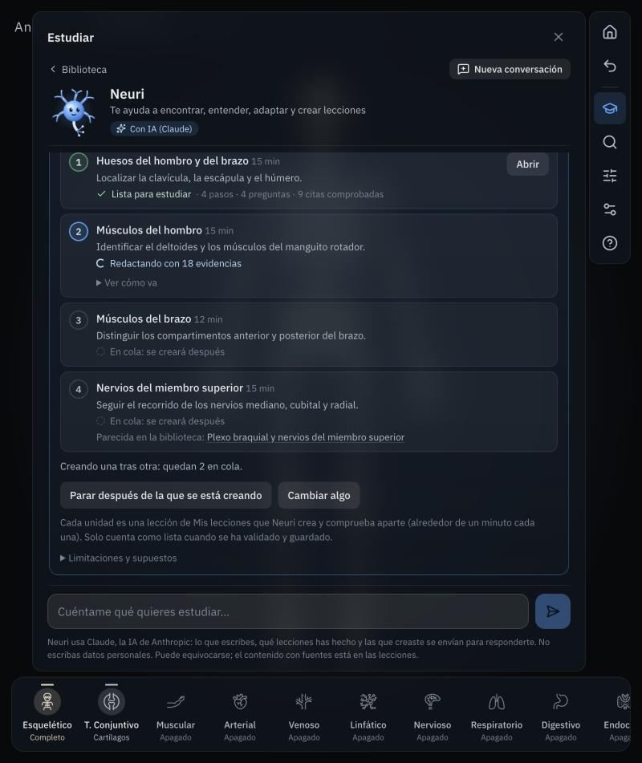

## 7. Adaptar, guardar, encontrar y quitar tus lecciones

**Dónde están:** **Mis lecciones**, en la entrada. También en el buscador, con el filtro «Procedencia: Mis lecciones».

**Cuántas caben:** hasta 40, solo en este navegador.

**Qué puedes hacer con cada una:**
- **Renombrar:** cambia el título, no el contenido ni tu progreso.
- **Pedir una adaptación:** Neuri crea **otra** lección (más corta, otro nivel, otro enfoque). La original y su progreso no cambian.
- **Descargar:** un archivo con esa lección.
- **Quitar de Mis lecciones:** pide confirmación y borra también su progreso. No se puede deshacer.

**Para todas:** **Exportar todas** e **Importar…** Al importar no se duplica ni se sobrescribe nada: si ya tienes una lección con ese nombre y otro contenido, entra como copia.

**En preparación** muestra las creaciones en curso y las que no terminaron bien. **Ver qué pasó** explica cada una y **Quitar** la olvida. Si es una unidad de un recorrido, dice de cuál.

**Mis recorridos**, arriba, muestra cada recorrido con el estado de sus unidades:
- **Abrir** una unidad lista;
- **Crear la unidad N**;
- **Seguir en la conversación**;
- **Quitar el recorrido**: no borra sus lecciones, que siguen en Mis lecciones. Si también quieres quitarlas, la confirmación tiene un botón aparte, **Quitar también sus N lecciones**, que avisa de que no se puede deshacer.

Cada lección que es una unidad dice de qué recorrido es.

**Cuando no cabe más:** no se borra nada solo. La creación queda «lista pero sin guardar» para descargarla o guardarla después de liberar espacio.

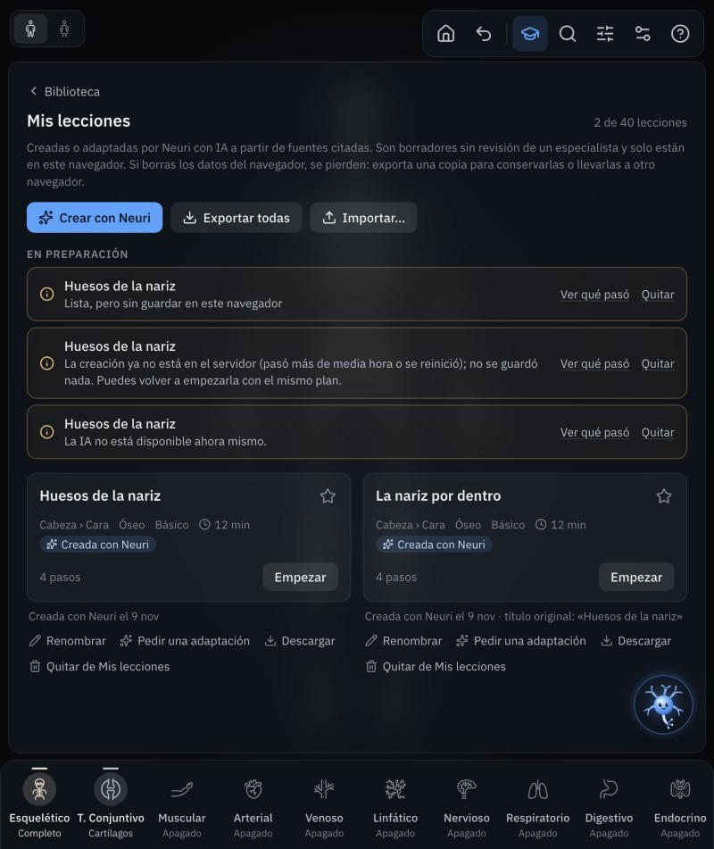

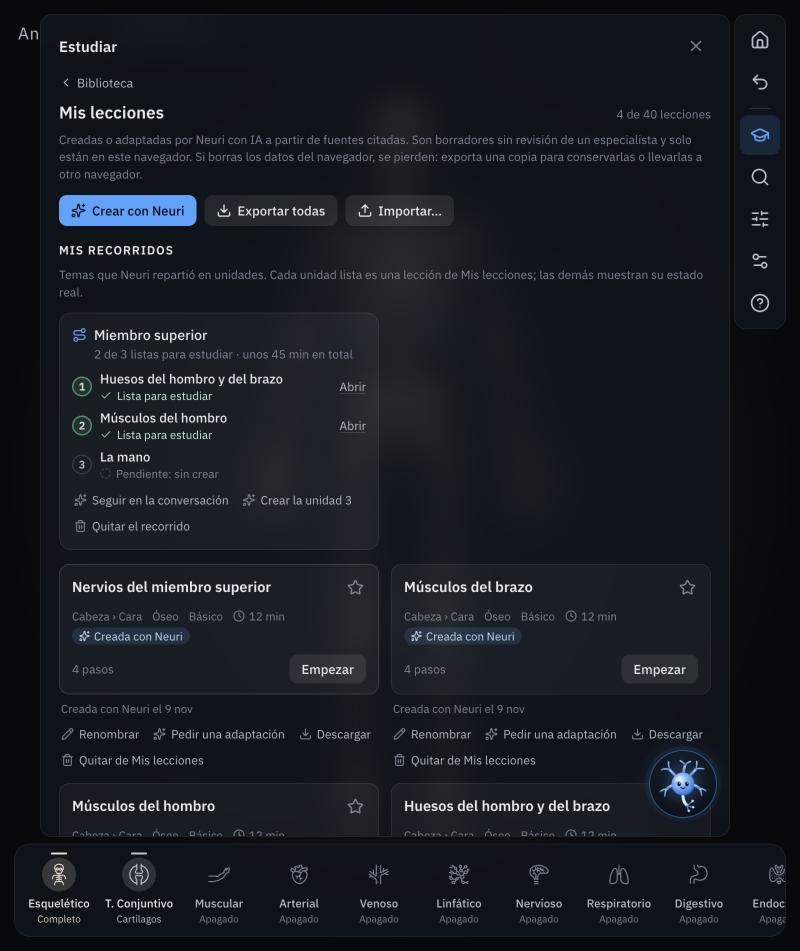

## 8. Preparar un examen con tu temario

1. Pulsa **Preparar un examen**. Escribe o pega el temario, un tema por línea. También vale separarlos con «;» o con viñetas.
2. Añade los datos del plan:
   - la fecha del examen, si la sabes. Sin fecha, el plan es de dos semanas: la app no inventa una;
   - el tiempo al día;
   - los días en que puedes estudiar.
3. **Ver lo que he entendido:** cada tema con sus lecciones. Marca las que quieres. Los temas sin lección quedan como **lagunas**, con **Pedir a Neuri que la cree**.
4. **Crear mi plan:**
   - **Hoy:** lo que toca, con **Empezar lo de hoy**;
   - **los próximos días:** lecciones y repasos espaciados;
   - un **repaso final** si cabe.

   Si no da el tiempo, lo dice con cifras y lista lo que no cabe.
5. **Reorganizar:**
   - el plan se rehace solo con lo que vas estudiando, siempre desde hoy, y conserva lo hecho;
   - **Ajustar el plan** cambia la fecha, el tiempo, los días o los temas;
   - **Borrar el plan** no toca tu progreso.

El temario solo dice qué estudiar: no se envía a ningún sitio ni se usa como fuente anatómica. No hay avisos por correo; el plan está en la app.

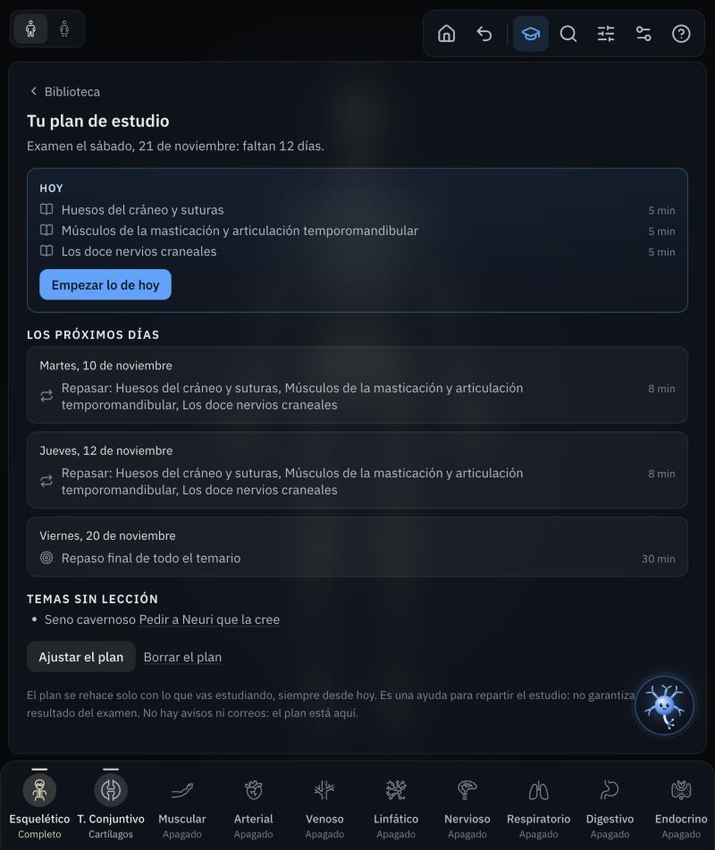

## 9. Cuenta y otro dispositivo: todavía no

**Hoy no se puede crear una cuenta ni sincronizar.** Falta elegir el alojamiento y el sistema de cuentas. Todo se guarda en este navegador y se pierde si borras sus datos.

**Para llevar tu estudio a otro navegador o dispositivo:**
1. En **Mis datos y privacidad**, pulsa **Exportar mis datos**. Descarga un archivo con:
   - tu progreso y tus respuestas;
   - Mis lecciones, tus recorridos y tus sesiones de estudio (una sesión en curso llega en pausa);
   - el plan de examen y tus preferencias.

   No lleva el identificador del dispositivo ni lo que Neuri recuerda del tema: son de este dispositivo.
2. En el otro navegador, **Importar…** ese archivo. Se combina con lo que haya:
   - no se duplica ni se borra nada;
   - de cada pregunta cuenta tu respuesta más reciente.

**En un ordenador compartido**, al terminar: **Borrar mis datos de estudio**.

## 10. Privacidad, copia, borrado y reportar un problema

### Mis datos y privacidad

Está en la entrada, abajo. Dice:
- **qué se guarda** en este navegador, con cifras;
- **qué sale de él:** a Neuri, la conversación y un resumen de tu progreso hecho solo de identificadores de lecciones; desde el 12 nov, también un perfil de aprendizaje calculado en tu dispositivo (preferencias, estado de cada habilidad, hasta seis dificultades, repasos pendientes, dónde estás si preguntas desde una lección y el avance de tu última sesión; sin respuestas ni fechas) y, en una cabecera aparte, el identificador aleatorio del dispositivo, solo para el cupo; con los reportes, lo del formulario. Nada más;
- **que para estudiar no hace falta Neuri:** sin IA, todo lo demás funciona igual.

| | |
| --- | --- |
| 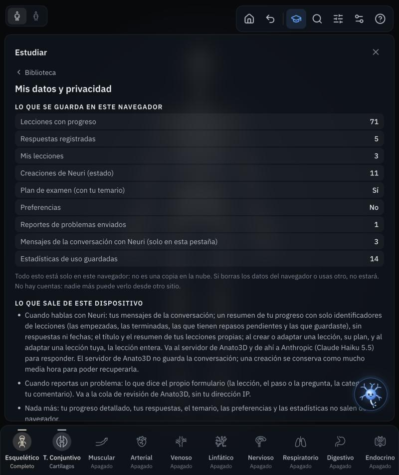 | 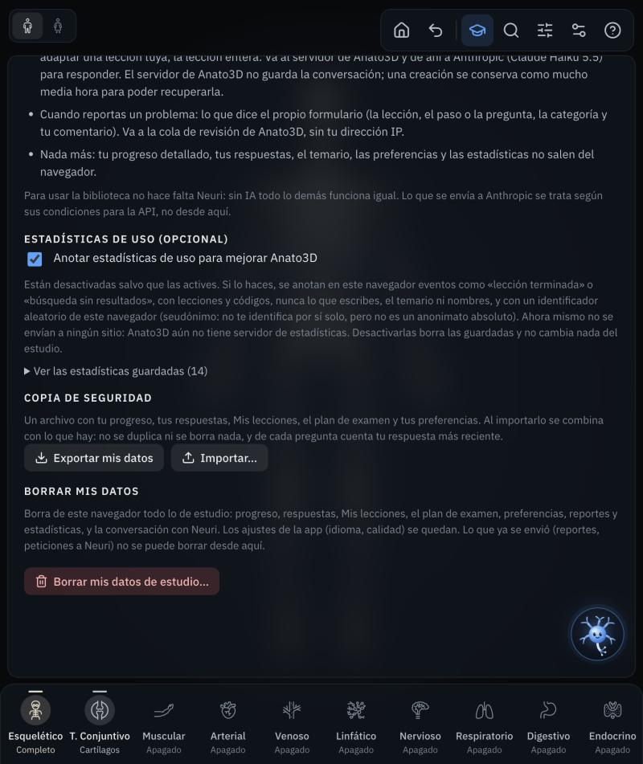 |

### Estadísticas de uso

Opcionales y **desactivadas** salvo que las actives.
- **Qué anotan:** eventos como «lección terminada», nunca lo que escribes, en este navegador y con un seudónimo aleatorio.
- **Envío:** hoy no se envían a ningún sitio. Puedes verlas y descargarlas.
- **Al desactivarlas** se borran, junto con el seudónimo.

### Copia y borrado

- **Exportar mis datos** e **Importar…** (ver el recorrido 9).
- **Borrar mis datos de estudio**, tras confirmar, quita todo lo de estudio de este navegador y deja el idioma y la calidad. Lo ya enviado (reportes, peticiones a Neuri) no se puede borrar desde aquí.

### Reportar un problema

Está en cada paso, cada pregunta y cada ficha.
- **Qué tipo de problema:** error anatómico, fuente que no corresponde, pregunta ambigua o mal corregida, problema del modelo 3D, traducción, algo que no funciona u otra cosa.
- **Comentario:** opcional.
- **Qué se envía:** la lección, su versión, el paso o la pregunta, la estructura, el idioma y el modelo. Ni tu nombre ni tus respuestas.
- **A quién llega:** a la cola de revisión. Si no hay conexión, se reenvía más tarde.
- **Si se corrige o se retira** la pregunta, sus fallos anteriores dejan de contar.

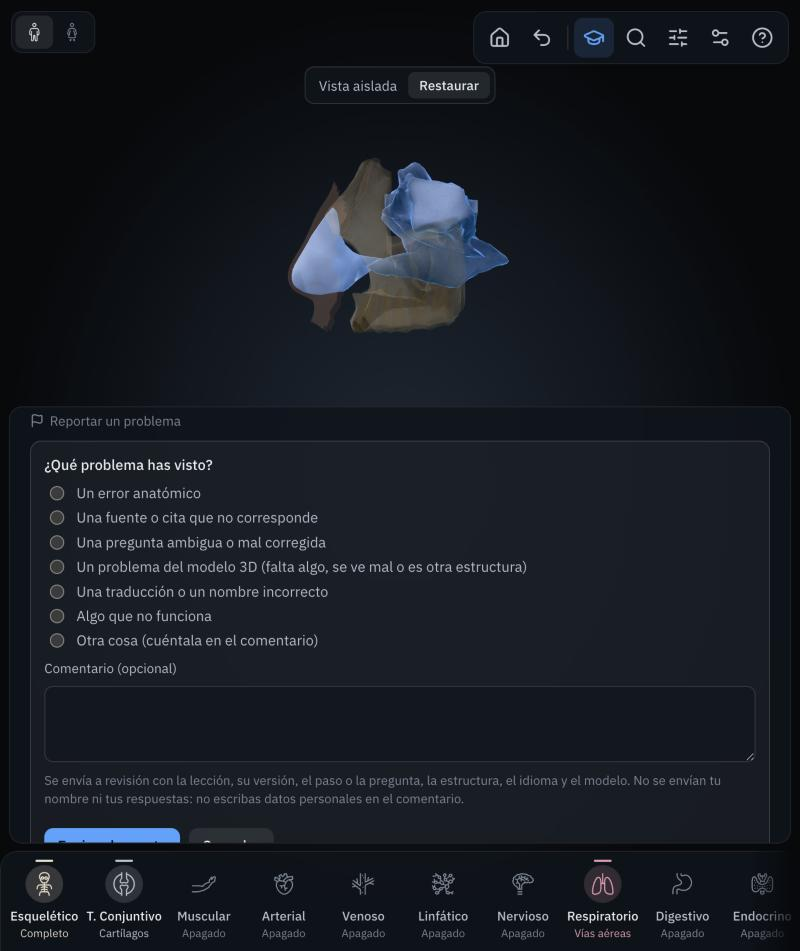

---

## En el móvil

La interfaz se adapta al ancho del móvil. Con el teclado abierto en Neuri se esconden la barra de sistemas y parte de la cabecera para que se vea la conversación.

Comprobado en el navegador emulando un móvil de 375 px, no en un teléfono físico.

| | |
| --- | --- |
| 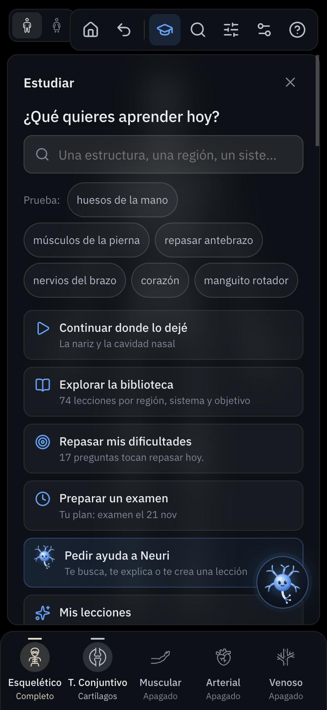 | 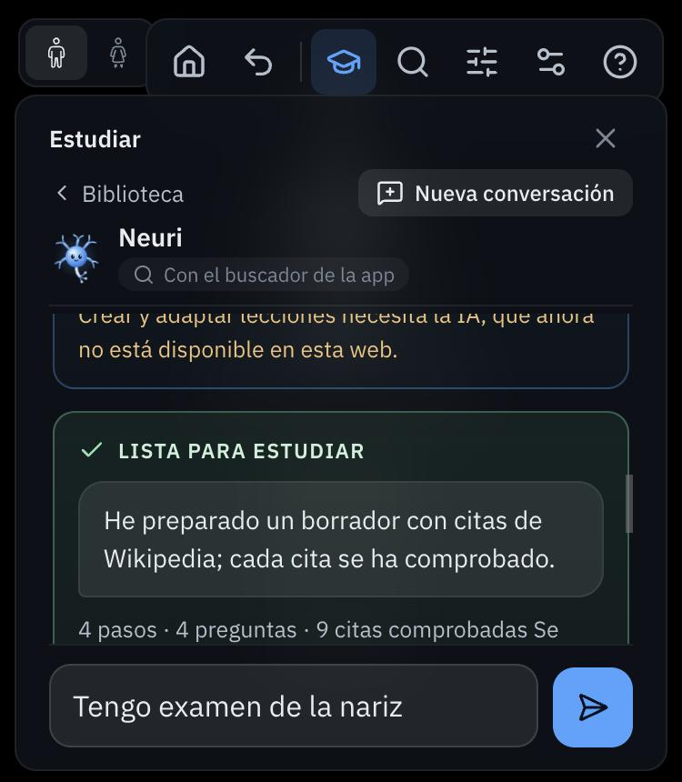 |

## Sin conexión

Funciona, una vez cargadas la página y los modelos:
- la biblioteca y las lecciones que ya abriste;
- el progreso, los repasos, el mapa y el plan de examen;
- Neuri con el buscador de la app.

Necesita conexión:
- abrir por primera vez una lección (se descarga al abrirla);
- recargar la página (no hay modo sin conexión instalado);
- Neuri con IA y crear lecciones;
- enviar reportes (se guardan y se reenvían después).

## Dónde se guarda cada cosa

| Qué | Dónde |
| --- | --- |
| Progreso, respuestas, repasos, preferencias y plan de examen | Este navegador (`localStorage`) |
| Mis lecciones, sus creaciones y tus recorridos | Este navegador |
| Tus sesiones de estudio (como mucho 20) | Este navegador |
| Conversación con Neuri | Esta pestaña: se borra al cerrarla |
| Lo que Neuri recuerda entre visitas (tema, objetivo, nivel y minutos) | Este navegador, 30 días; no se exporta |
| Identificador aleatorio del dispositivo (solo para el cupo diario) | Este navegador; no se exporta |
| Cuántas preguntas y creaciones con IA llevas hoy | El servidor de Anato3D, sin tu IP ni el identificador: solo números y claves HMAC que no permiten recuperarlos, del día |
| Lo que se envía a Neuri | Al servidor de Anato3D y de ahí a Anthropic (Claude Haiku 5.5); el servidor no guarda la conversación |
| Reportes | Este navegador y la cola de revisión de Anato3D, sin tu dirección IP |
| Estadísticas (si las activas) | Solo este navegador |

El detalle técnico está en `docs/estudio/contratos-datos.md`.

## Limitaciones conocidas

**Contenido:**
- Las 87 lecciones son **borradores** que nadie ha revisado todavía: las redactó una IA a partir de fuentes citadas.
- El contenido de las 85 lecciones nuevas está solo en español. Brazo y antebrazo están en cinco idiomas, traducidos con IA y sin revisar.

**Idiomas de la app:** desde el 12 nov de 2026 la app se usa en **español o inglés** (inglés por defecto). Alemán, francés e italiano salen en la lista como «próximamente» y no se pueden elegir todavía; si los tenías elegidos, la app pasa al inglés. Lo nuevo (sesiones, cupo, «Preguntar a Neuri sobre este paso») solo está en español e inglés.
- Hay huecos de la anatomía sin lección: `docs/estudio/cobertura.md` los cuenta.

**Modelo 3D:**
- Tres piezas tienen errores conocidos:
  - el surco paracentral está fuera de sitio;
  - el surco temporal inferior tiene un nombre dudoso;
  - la arteria meníngea media está incompleta.

  Su ficha lo avisa en ámbar, con la explicación y las fuentes.
- Las dos primeras no se usan para preguntarte en el modelo ni como opción falsa. Tus respuestas antiguas sobre ellas se guardan, pero no cuentan ni vuelven al repaso.
- Si por eso un objetivo de una lección se queda sin preguntas, la evaluación lo dice y no da la lección por demostrada.
- Solo se han examinado estas tres piezas: puede haber otros errores. Si ves uno, usa «Reportar un problema».

**Neuri:**
- Usa Claude Haiku 5.5 y puede equivocarse: el contenido con fuentes está en las lecciones.
- Crear lecciones y recorridos con la IA real está programado y probado con simulaciones, pero **aún no con el servicio real**. Lo mismo las sesiones que planifica Neuri con la IA; las que planifica tu dispositivo no necesitan IA.
- Con IA, como mucho 30 preguntas y 3 creaciones al día en este dispositivo.

**Cuentas y web publicada:** no hay cuentas, sincronización ni web publicada todavía.

**Accesibilidad:** probada con el teclado y en un móvil emulado; **falta probarla** con un lector de pantalla y en un teléfono real.
